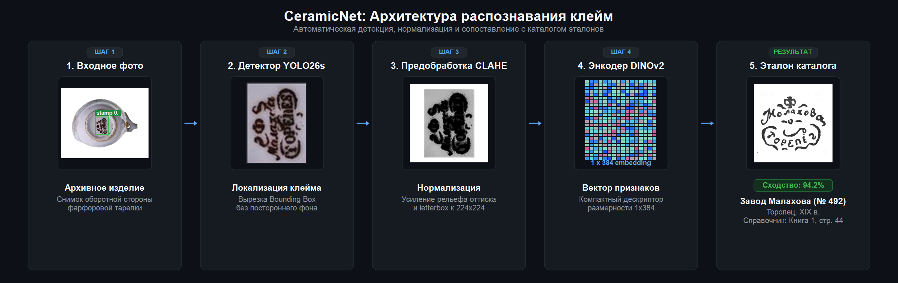
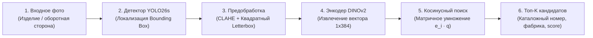

# CeramicNet

[](https://www.python.org/)
[](https://pytorch.org/)
[](https://github.com/ultralytics/ultralytics)
[](https://github.com/facebookresearch/dinov2)
[](https://onnxruntime.ai/)
[](https://clear.ml/)

CeramicNet — двухстадийная система компьютерного зрения для автоматической локализации, извлечения дескрипторов и каталожной атрибуции фабричных клейм на фарфоровых и керамических изделиях.

---

## Пайплайн обработки данных

Система принимает на вход фотографию керамического изделия и выполняет атрибуцию клейма по эталонной базе справочников:





### Этапы работы:
1. **Входное изображение**: фотография донца или фрагмента изделия с оттиском клейма.
2. **Локализация (YOLO26s)**: детекция координат клейма и вырезание интересующей области (Region of Interest).
3. **Предобработка (CLAHE + Letterbox)**: адаптивная инверсия тона (при светлых оттисках на темной глине) и локальное выравнивание гистограммы (`clipLimit=2.0`), восстанавливающее рельефные линии без усиления шума глазури.
4. **Метрический энкодер (DINOv2 ViT-S/14)**: трансформер проецирует патчи изображения в L2-нормализованный вектор размерности 384.
5. **Векторный поиск**: матричное умножение вектора запроса на матрицу каталога ($\text{scores} = \mathbf{E} \cdot \mathbf{q}$) с ранжированием кандидатов по косинусному сходству.

---

## Архитектура и методы

### Постановка задачи: Open-Set Retrieval
В музейной и коллекционной практике база клейм постоянно расширяется. Стандартный классификатор требует полного переобучения при добавлении каждого нового завода или мастера. CeramicNet решает задачу как метрический поиск (Open-Set Retrieval): новые эталоны добавляются в векторный индекс напрямую через вычисление их эмбеддингов без дообучения сети.

### Детектор (YOLO26s)
* **Архитектура**: Ultralytics YOLO26s (260 слоев, 9.95 млн параметров, 22.7 GFLOPs).
* **Фоновые негативы**: обучающая выборка содержит 45 чистых фоновых снимков (ручки, узоры, трещины глазури без клейм), а валидационная — 94 фоновых снимка. Это подавляет ложные срабатывания (False Positives) на сложных текстурах керамики.
* **Функция потерь**: комбинированный лосс из CIoU (координаты, центры и пропорции рамки), DFL (регрессия размытых контуров) и BCE (бинарная классификация наличия клейма).

### Энкодер (DINOv2 ViT-S/14 Metric Encoder)
* **Бэкбон**: `dinov2_vits14` с заморозкой основной части и разморозкой последних двух блоков внимания (`blocks[-2:]`) и финального слоя нормализации (`norm`).
* **Проектор**: `Linear(384, 512) -> BatchNorm1d -> PReLU -> Linear(512, 384) -> L2-Normalize`.
* **Функция потерь**: Supervised Contrastive Loss (`SupConLoss`, $\tau = 0.07$) в связке с майнером сложных негативов `MultiSimilarityMiner(epsilon=0.1)`. Майнер отбирает визуально схожие клейма разных заводов внутри батча, заставляя модель учитывать микроструктуру шрифтов и символики.
* **Аугментации**: контрастивная схема обучения Two-View: сопоставление чистого эталона (`clean_transform`) и искаженного фрагмента (`heavy_crop_transform`: кроп от 40% площади, поворот $\pm 15^\circ$, вариации контраста).

---

## Экспериментальные результаты

### Детекция (валидационный набор 145 изображений)

| Модель | Разрешение | mAP@50 | mAP@50-95 | Precision | Recall | Вес ONNX | Время инференса (GPU) |
| :--- | :---: | :---: | :---: | :---: | :---: | :---: | :---: |
| **YOLO26s (v2, с негативами)** | **640x640** | **0.935** | **0.702** | **0.879** | **0.857** | **36.4 МБ** | **11.5 мс** |
| RTMDet-s (v3) | 640x640 | 0.882 | 0.654 | 0.851 | 0.824 | 35.8 МБ | 14.2 мс |
| YOLO26s (v1 baseline) | 640x640 | 0.891 | 0.648 | 0.912 | 0.804 | 36.4 МБ | 11.5 мс |

**RT-DETRv2-S:** добавлен адаптер с интерфейсом `YOLOProcessing` и поддержкой
двух выходов ONNX; проверки интерфейса и предобработки пройдены.
На восстановленной валидации ноутбука (61 фото: 47 с клеймами и 14 негативов)
получены следующие результаты:

| Модель | COCO mAP@50 | COCO mAP@50-95 | Precision | Recall | F1 | Время на CPU Apple M5 |
| :--- | :---: | :---: | :---: | :---: | :---: | :---: |
| RT-DETRv2-S, 640x640 | 0.9610 | 0.7358 | 1.0000 | 0.8723 | 0.9318 | 215.43 мс |

COCO AP рассчитан при `conf>0.001`; Precision/Recall/F1 — при `conf>0.75`
и IoU сопоставления 0.5, NMS IoU 0.5. Эта валидация использовалась при выборе
лучшей эпохи и отличается от набора на 145 фото выше. Результаты не являются
прямым сравнением моделей или независимым тестом.
[Подробный отчёт, исходные предсказания и воспроизведение](experiments/detection/rtdetr/README.md).

### Ретривал клейм (независимый тестовый набор)

| Модель | Бэкбон | Val Recall@1 | Val Recall@5 | Hit@1 | Hit@3 | MRR |
| :--- | :--- | :---: | :---: | :---: | :---: | :---: |
| **stamp_encoder_v2** | **DINOv2 ViT-S/14** | **99.55%** | **100.00%** | **0.300** | **0.500** | **0.407** |
| stamp_encoder_v1 | Barlow Twins Student | 88.40% | 94.20% | 0.200 | 0.300 | 0.291 |
| baseline_raw | ResNet50 | 65.10% | 81.30% | 0.100 | 0.150 | 0.145 |

---

## Структура репозитория

```text
CeramicNet/
├── configs/                   # Конфигурационные файлы детектора и ретривала
│   ├── detection/             # Пороги уверенности, NMS, пути к весам детектора
│   └── retrieval/             # Параметры энкодера, top_k, конфигурации каталогов
├── data/
│   ├── books/                 # Каталоги клейм по книгам и фабрикам
│   ├── books_index/           # Скомпилированные векторные индексы (.npz)
│   └── ceramic_dataset/       # Датасет фотографий (images, negatives, annotations)
├── experiments/               # Отчеты и численные данные экспериментов
├── notebooks/                 # Ноутбуки обучения (Kaggle / ClearML)
│   ├── detection/yolo/        # Пайплайн обучения YOLO26s
│   └── retrieval/             # Пайплайн дообучения DINOv2 с SupConLoss
├── reports/                   # Сводные таблицы метрик и превью валидации
├── scripts/                   # Скрипты бенчмарков и визуализации
│   ├── retrieval_test.py      # Сравнительный тест энкодеров по Hit@K и MRR
│   └── visualize_retrieval_test.py # Визуализация разметки эталонов
├── src/                       # Основные модули системы
│   ├── detection/             # Обвязка ONNX-детектора
│   ├── retrieval/             # Энкодер DINOv2, векторный индекс, чтение книг
│   ├── pipeline.py            # Класс CeramicPipeline (детекция + поиск)
│   └── utils.py               # Загрузка конфигураций и препроцессинг
├── weights/                   # Оптимизированные веса моделей в формате ONNX
├── main.py                    # Точка входа для инференса
└── download_artifacts.py      # Загрузка весов и данных из хранилища
```

---

## Установка и запуск

### 1. Подготовка окружения

```bash
git clone https://github.com/mishasavinov/CeramicNet.git
cd CeramicNet

python -m venv .venv
source .venv/bin/activate  # Для Linux/macOS
# .venv\Scripts\activate   # Для Windows

pip install -r requirements.txt
```

### 2. Загрузка моделей и векторного индекса

```bash
python download_artifacts.py --folder_id <GOOGLE_DRIVE_FOLDER_ID>
```

Файлы моделей размещаются в директории `weights/`:
* `ceramic_yolo26s.onnx` — детектор клейм (ONNX opset 18, 36.4 МБ).
* `stamp_encoder_v2.onnx` — метрический энкодер DINOv2 (ONNX opset 14, 84 МБ).
* `reference_index.npz` — векторный индекс эталонов каталогов.

---

## Примеры использования

### Сквозная обработка тестового снимка

Запуск детекции и поиска на случайном изображении из датасета с выводом визуализации:

```bash
python main.py --random 1 --show
```

### Обработка пользовательского изображения

```bash
python main.py --input path/to/image.jpg --model stamp_encoder_v2 --top-k 5 --show
```

### Запуск бенчмарка моделей ретривала

Вычисление метрик Hit@1, Hit@3, Hit@5 и MRR на тестовой выборке:

```bash
python -m scripts.retrieval_test
```

### Экспорт карточек экспертной разметки

Генерация пар «запрос — размеченные человеком эталоны»:

```bash
python -m scripts.visualize_retrieval_test --max-items 20
```

Карточки сохраняются в каталог `reports/ground_truth_previews/`.

---

## Технический стек

* **Глубокое обучение и модели**: PyTorch, Torchvision, Ultralytics YOLO, Meta DINOv2.
* **Метрическое обучение**: PyTorch Metric Learning (SupConLoss, MultiSimilarityMiner).
* **Среда инференса**: ONNX Runtime, OnnxSlim.
* **Обработка изображений**: OpenCV, Albumentations, NumPy, Pillow.
* **Трекинг экспериментов**: ClearML.

---

## Лицензия

Проект распространяется под лицензией MIT.
