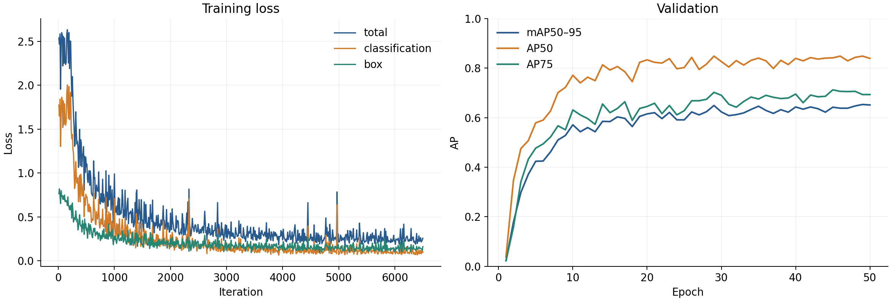
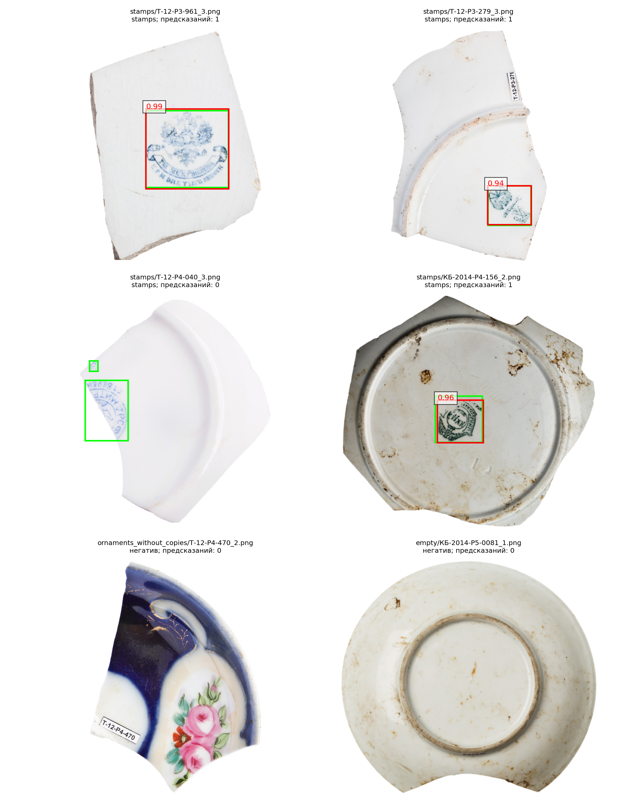

# RTMDet-s · v3

50 эпох · 640 px · batch 2 · seed 42 · CPU. Train **259**, val **145** фото (94 негатива); лучший checkpoint — **49-я эпоха**.

| mAP50–95 | AP50 | Precision @ 0.84 | Recall @ 0.84 |
| --- | --- | --- | --- |
| 0.6536 | 0.8481 | 0.9000 | 0.5192 |

COCO-оценка на val. На val выбирались веса и порог; независимого test нет, есть пересечения предметов train/val.

Confidence **0.84**; зелёные рамки — разметка, красные — детектор. Это предварительные примеры, выбранные в исходном ноутбуке.

[PR по порогам, IoU 0.5](precision_recall.png) · [Зависимость от порога](confidence_curves.png) · [Метрики](metrics.json) · [ClearML](https://app.clear.ml/projects/667be44d3e6345ff8c818f4a5261b3f7/tasks/7e70ead7461e4d93888f7d17e169b5ec/output/scalars)

[Ноутбук обучения](train.ipynb) · [Как воспроизвести](reproduce.md) · [Источники](provenance.json).
