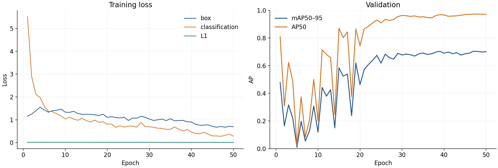
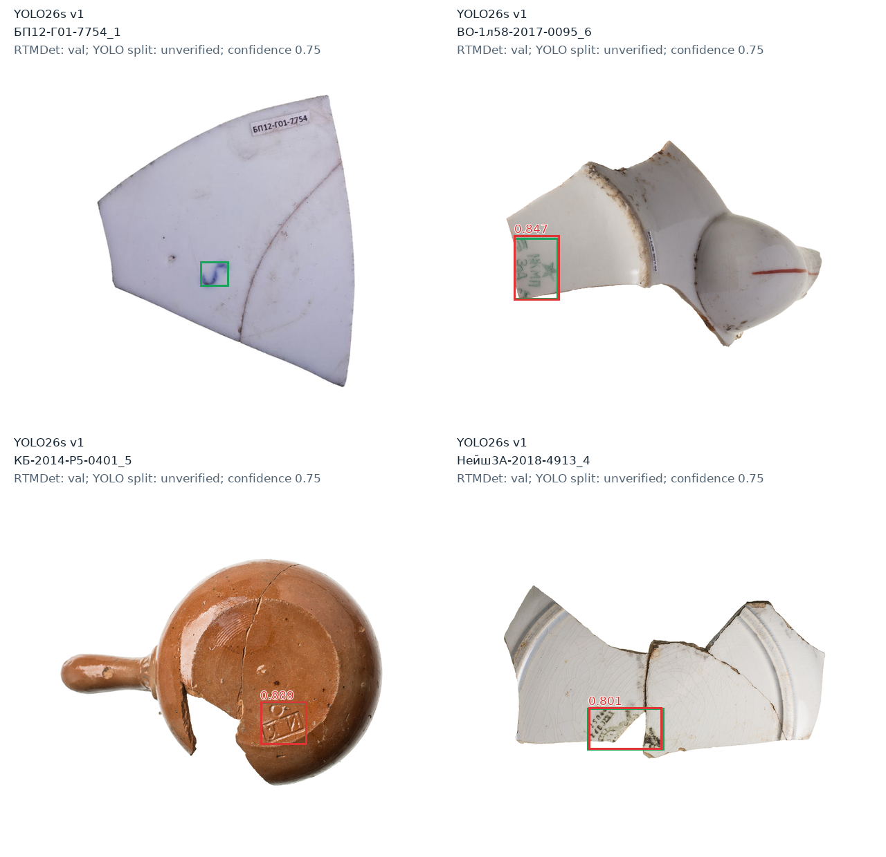

# YOLO26s · v1

50 эпох · 640 px · batch 16 · seed 0 · AdamW · Tesla T4. Train **243**, val **61** фото (10 негативов).

| mAP50–95 | AP50 | Precision | Recall |
| --- | --- | --- | --- |
| 0.7051 | 0.9729 | 0.9056 | 0.9405 |

Метрики `best.pt` из ClearML; независимого test нет. В ноутбуке есть и повторный `model.val()`: mAP50–95 = 0.702; он сохранён отдельно в JSON.

Четыре выбранных фото из **RTMDet val**, confidence **0.75** из конфигурации общего приложения. Их split для исторического YOLO не подтверждён; картинки не являются новой оценкой качества. P/R в таблице — исторические значения валидатора.

PR-картинка v1 пока недоступна; её старый адрес в ClearML отвечает 404. [Метрики](metrics.json) · [История обучения](training_history.csv) · [ClearML](https://app.clear.ml/projects/d6209850b8fb417bb10decb4dfaccfd8/tasks/fa3c17a1e8e544fea4628c326a4b5a3e/output/scalars)

[Ноутбук обучения](../../../../notebooks/detection/yolo/yolo_v1_train_pipeline.ipynb) · [Как воспроизвести](reproduce.md). Код не дублируется; [источники и ограничения](provenance.json).

[Все 23 выбранных фото](examples/README.md) · [Проверка разбиения](../../selected_images.md) · [Исходные примеры ноутбука](notebook_examples.png).
