# YOLO26s v1: все 23 выбранных фото

Confidence **0.75**. Зелёные рамки — разметка RTMDet v3; красные — детектор.

В списке 4 val и 19 train по сохранённому split RTMDet. Это иллюстрации; по ним не считается итоговое качество.

### БП12-Г01-3414_6

RTMDet split: **train**. Исторический YOLO split не подтверждён. Детекций: 1.

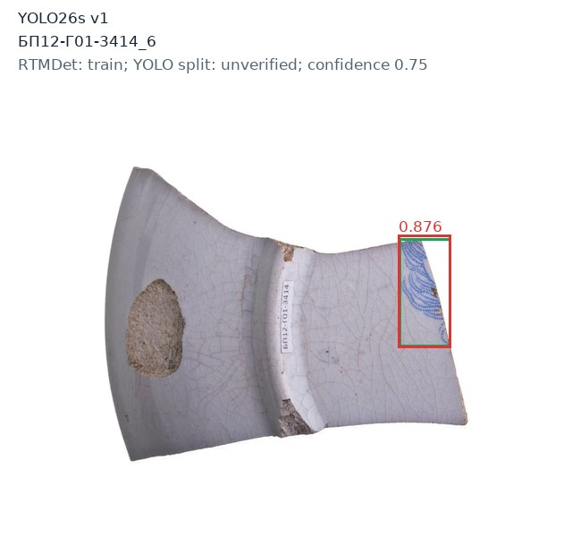

### БП12-Г01-5845_5

RTMDet split: **train**. Исторический YOLO split не подтверждён. Детекций: 1.

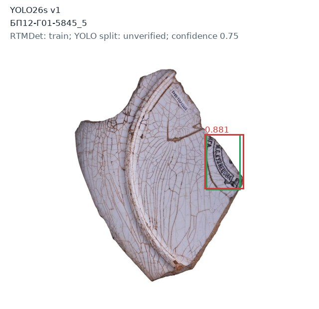

### БП12-Г01-5848_10

RTMDet split: **train**. Исторический YOLO split не подтверждён. Детекций: 0.

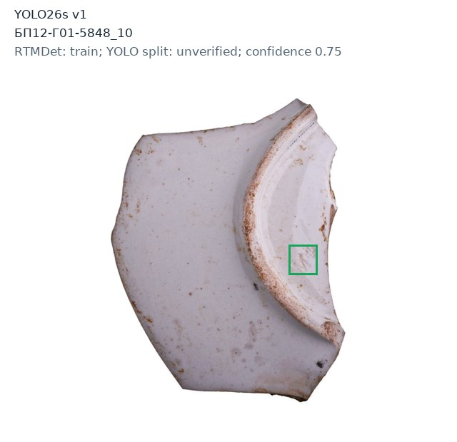

### БП12-Г01-7754_1

RTMDet split: **val**. Исторический YOLO split не подтверждён. Детекций: 0.

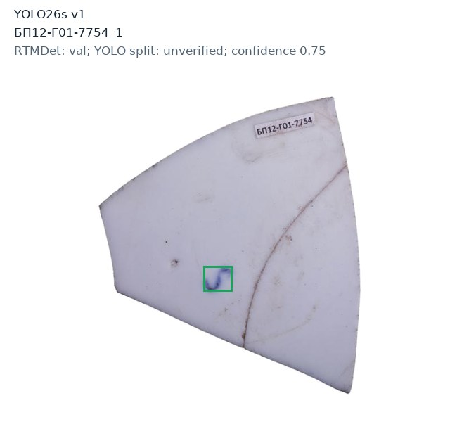

### БП12-Т01-8070_11

RTMDet split: **train**. Исторический YOLO split не подтверждён. Детекций: 1.

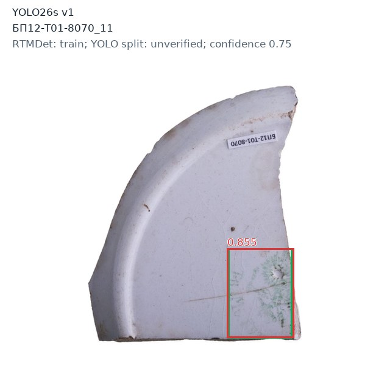

### ВО-1л58-2017-0085_3

RTMDet split: **train**. Исторический YOLO split не подтверждён. Детекций: 1.

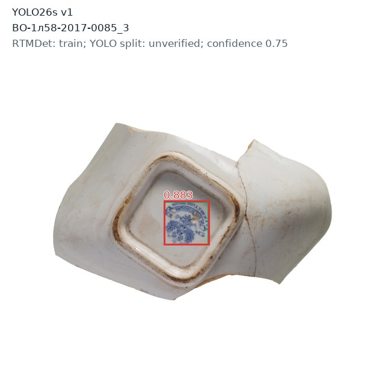

### ВО-1л58-2017-0095_6

RTMDet split: **val**. Исторический YOLO split не подтверждён. Детекций: 1.

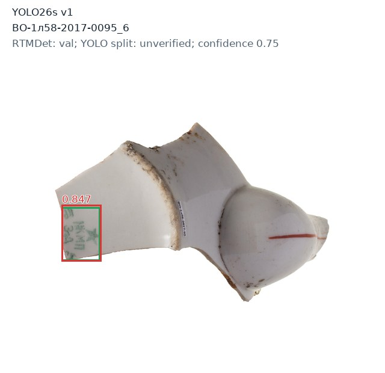

### КБ-2014-Р1-0257_6

RTMDet split: **train**. Исторический YOLO split не подтверждён. Детекций: 1.

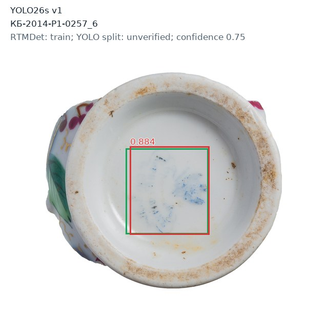

### КБ-2014-Р1-0281_5

RTMDet split: **train**. Исторический YOLO split не подтверждён. Детекций: 1.

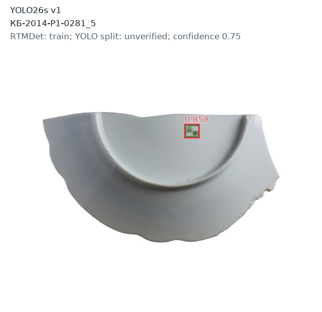

### КБ-2014-Р1-0718_2

RTMDet split: **train**. Исторический YOLO split не подтверждён. Детекций: 1.

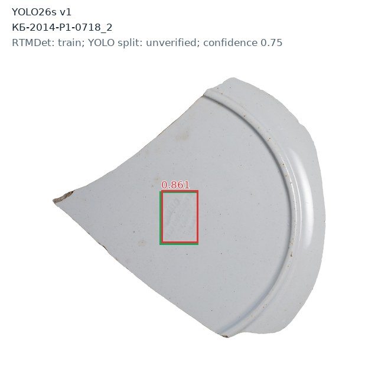

### КБ-2014-Р1-0855_4

RTMDet split: **train**. Исторический YOLO split не подтверждён. Детекций: 1.

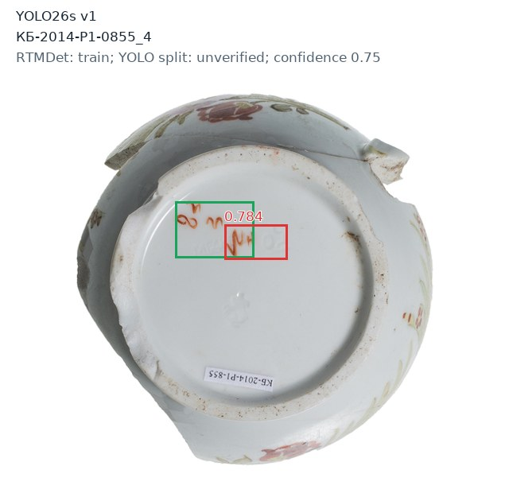

### КБ-2014-Р1-1185_5

RTMDet split: **train**. Исторический YOLO split не подтверждён. Детекций: 1.

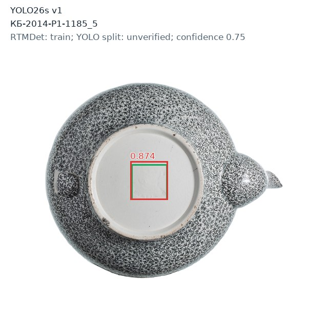

### КБ-2014-Р1-1455_5

RTMDet split: **train**. Исторический YOLO split не подтверждён. Детекций: 1.

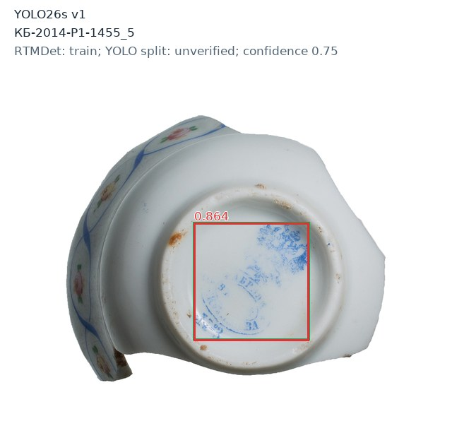

### КБ-2014-Р2-0597_2

RTMDet split: **train**. Исторический YOLO split не подтверждён. Детекций: 2.

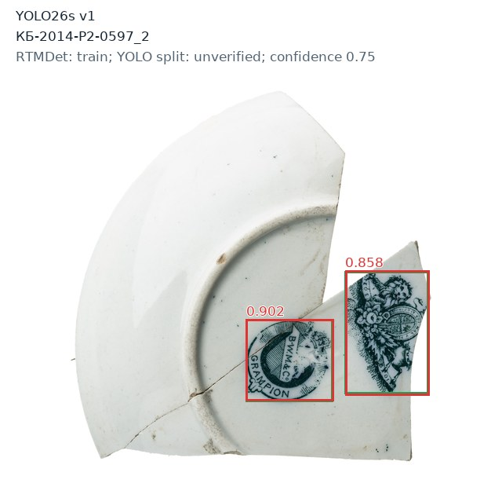

### КБ-2014-Р2-0610_16

RTMDet split: **train**. Исторический YOLO split не подтверждён. Детекций: 0.

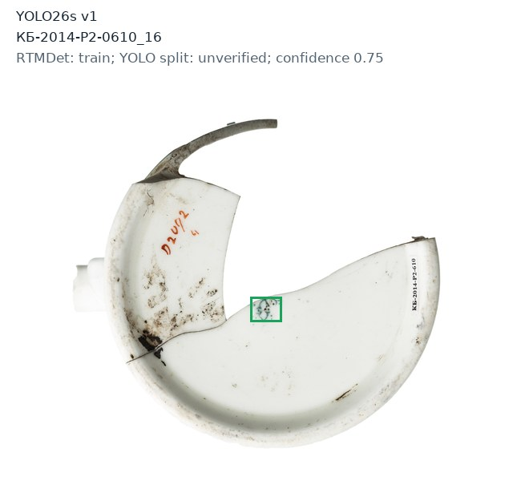

### КБ-2014-Р3-0049_2

RTMDet split: **train**. Исторический YOLO split не подтверждён. Детекций: 2.

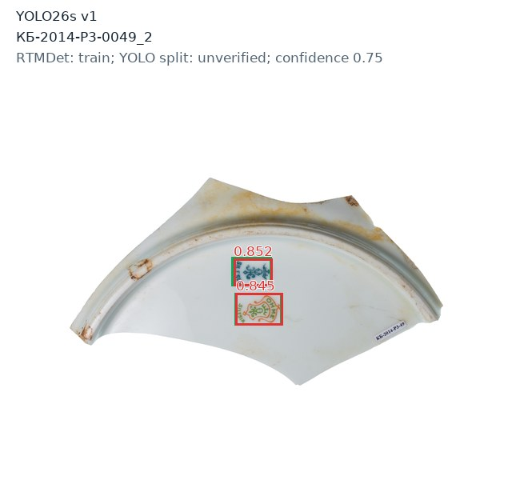

### КБ-2014-Р5-0056_15

RTMDet split: **train**. Исторический YOLO split не подтверждён. Детекций: 0.

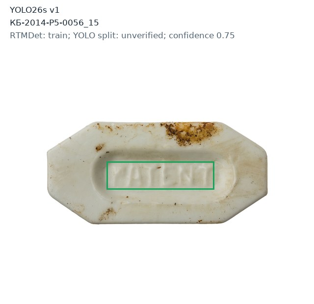

### КБ-2014-Р5-0401_5

RTMDet split: **val**. Исторический YOLO split не подтверждён. Детекций: 1.

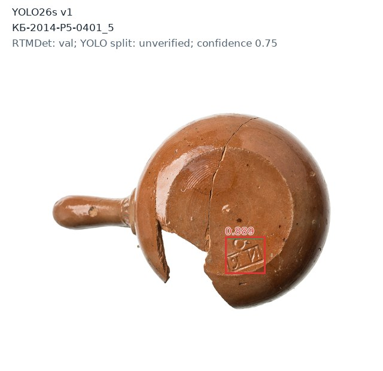

### Кроп-2013-486_5

RTMDet split: **train**. Исторический YOLO split не подтверждён. Детекций: 1.

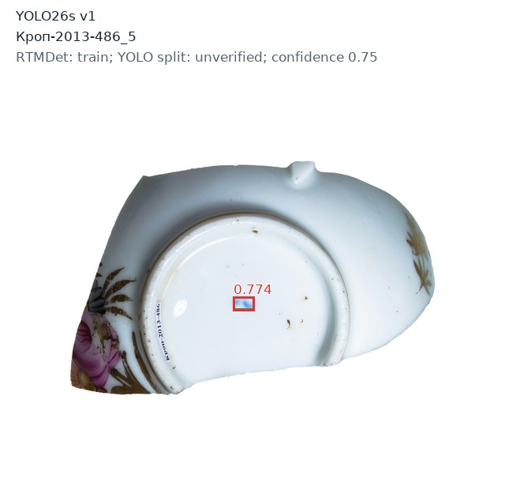

### ЛАО-2012-М102-Ш1-020_7

RTMDet split: **train**. Исторический YOLO split не подтверждён. Детекций: 1.

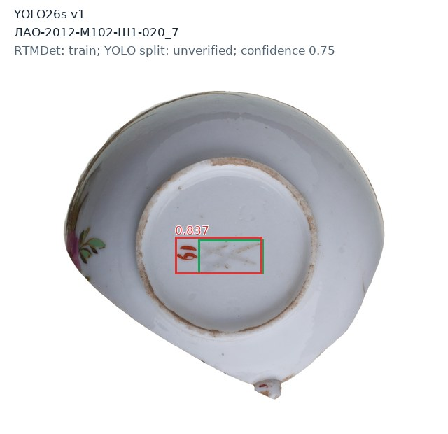

### Нейш3А-2018-4913_4

RTMDet split: **val**. Исторический YOLO split не подтверждён. Детекций: 1.

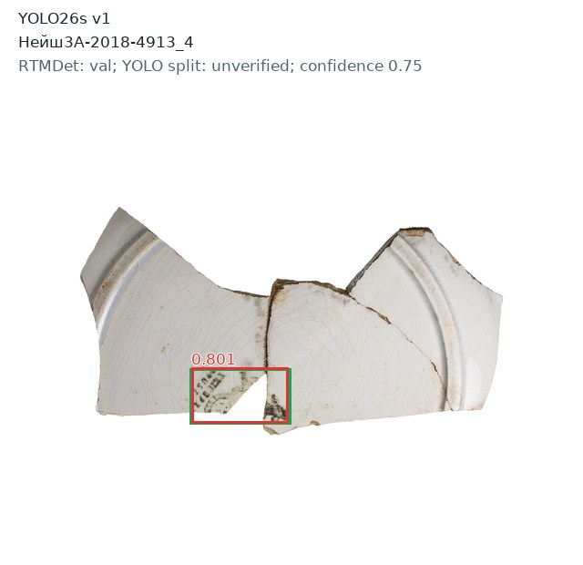

### Нейш3А-2018-5721_1

RTMDet split: **train**. Исторический YOLO split не подтверждён. Детекций: 1.

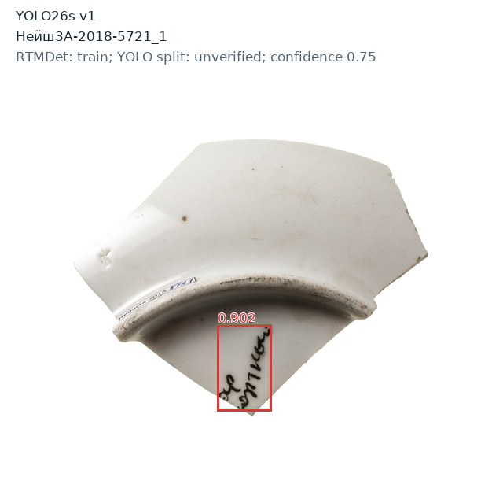

### Нейш3А-2018-6345_13

RTMDet split: **train**. Исторический YOLO split не подтверждён. Детекций: 1.

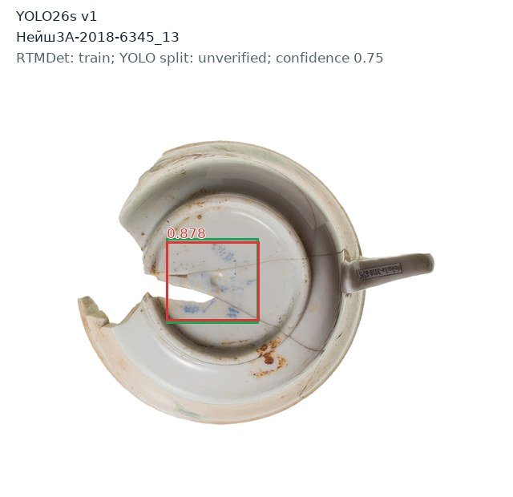
