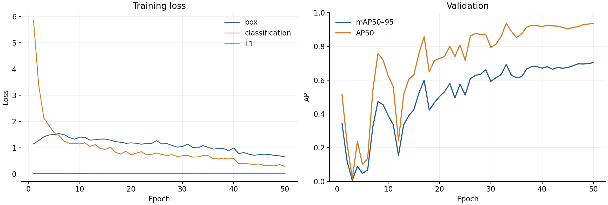
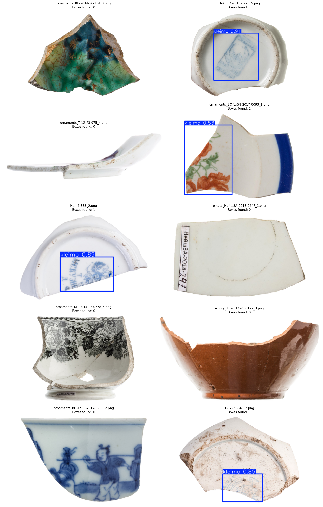

# YOLO26s · v2

50 эпох · 640 px · batch 16 · seed 0 · AdamW · Tesla T4. Train **248**, val **145** фото (94 негативов).

| mAP50–95 | AP50 | Precision | Recall |
| --- | --- | --- | --- |
| 0.7022 | 0.9349 | 0.8793 | 0.8571 |

Метрики `best.pt` из ClearML; независимого test нет.

Примеры из исходного ноутбука, confidence **0.25**; это не согласованный набор для сравнения моделей. P/R в таблице — значения валидатора, не оценка этих десяти примеров.

[PR-кривая](precision_recall.png) · [Метрики](metrics.json) · [История обучения](training_history.csv) · [ClearML](https://app.clear.ml/projects/d6209850b8fb417bb10decb4dfaccfd8/tasks/f1e9824d5941477989f9641f42e62622/output/scalars)

[Ноутбук обучения](../../../../notebooks/detection/yolo/yolo_v2_train_pipeline.ipynb) · [Как воспроизвести](reproduce.md). Код не дублируется; [источники и ограничения](provenance.json).
